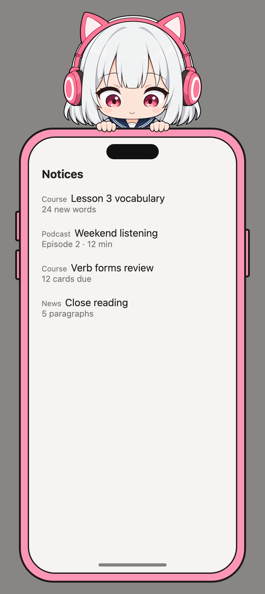

# no-chan

English · [中文](README.zh-CN.md)

A mascot (看板娘) for React apps. She stands at the bottom of your page: pick her up and she dangles, let go and she falls, leave her alone and she yawns, sways to her music or dozes off against a wall. She reacts to what your app tells her, and while she reads her phone, a click on her opens her phone as a panel for your content. She also comes as a button, hanging on its bottom edge and peeking out at the user now and then.

<table>
  <tr>
    <td align="center"></td>
    <td align="center"></td>
  </tr>
  <tr>
    <td align="center"><code>&lt;NooChan&gt;</code></td>
    <td align="center"><code>&lt;NooChanDialog&gt;</code></td>
  </tr>
</table>

- [Usage](#usage)
- [Extending](#extending)
- [Development](#development)
- [License](#license)

## Usage

### Install

no-chan needs React 19 and Vite. It is shipped as TypeScript source that uses Vite's `import.meta.glob`, so your app's Vite compiles it along with your code.

```bash
pnpm add no-chan
# or straight from GitHub
pnpm add github:YoRHazero/no-chan
```

```ts
// vite.config.ts
export default defineConfig({
  plugins: [react()],
  // Compile no-chan with your code rather than pre-bundling it.
  optimizeDeps: { exclude: ['no-chan'] },
})
```

### Use

```tsx
import { useState } from 'react'
import { createNooChan, NooChan, NooChanDialog } from 'no-chan'

// One controller for the whole app, in a module, so any code can reach her.
export const nooChan = createNooChan()

export function Layout() {
  const [noticesOpen, setNoticesOpen] = useState(false)
  return (
    <>
      {/* your page */}
      <NooChan
        controller={nooChan}
        hasNotice={notices.length > 0}
        onClick={() => setNoticesOpen(true)}
      />
      <NooChanDialog open={noticesOpen} onOpenChange={setNoticesOpen}>
        <NoticeList notices={notices} />
      </NooChanDialog>
    </>
  )
}

// Anywhere in the app, tell her what happened:
nooChan.notifyError() // something failed: she looks troubled
nooChan.notifyRequest(button.getBoundingClientRect()) // a request went out: a paper ball flies at her
```

What your app _is_ goes in through props; what _happens_ in it goes through the controller.

### `createNooChan()`

Makes the controller to pass to `<NooChan>`.

| Method                | What it tells her                                                                                                                                        |
| --------------------- | -------------------------------------------------------------------------------------------------------------------------------------------------------- |
| `notifyError()`       | Something the user did failed. She looks troubled.                                                                                                       |
| `notifyRequest(from)` | The user sent a request from `from`: a `DOMRect` such as a button's, or an `{ x, y }` point in the viewport. A paper ball flies from there and hits her. |

While she is not on the page, what the controller is told is dropped.

### `<NooChan>`

| Prop         | Type                             | Description                                                                                         |
| ------------ | -------------------------------- | --------------------------------------------------------------------------------------------------- |
| `controller` | `NooChanController`              | Required. What `createNooChan()` returned.                                                          |
| `bounds`     | `RefObject<HTMLElement \| null>` | The element she lives in: its bottom is the floor, its sides are the walls. The window if left out. |
| `timeUnit`   | `number`                         | Milliseconds per time unit of her animations. Default `100`.                                        |
| `hasNotice`  | `boolean`                        | Whether your app has something for the user. While it does, she reads her phone.                    |
| `onClick`    | `() => void`                     | She was clicked, without being dragged, while reading her phone.                                    |

On her own, she:

- dangles from your cursor when dragged, falls when let go, and sits a moment where she lands;
- yawns or sways to her music every so often while standing;
- sits down against the wall to sleep when she stands near one and nobody has touched the mouse or keyboard for three minutes; any input wakes her.

She first appears 80px from the right edge. Unmounted and mounted again, she comes back where she stood; everything else starts over. Her frames and runtime load in a chunk of their own the first time she is shown, and she appears once every frame has decoded. If loading fails, she just doesn't appear.

### `<NooChanDialog>`

| Prop           | Type                      | Description                                                                                    |
| -------------- | ------------------------- | ---------------------------------------------------------------------------------------------- |
| `open`         | `boolean`                 | Required. Whether it is open; your app holds this.                                             |
| `onOpenChange` | `(open: boolean) => void` | Required. The user closed it: the home bar, Esc, or a click outside the phone. Always `false`. |
| `children`     | `ReactNode`               | What the phone's screen shows. It scrolls inside the screen.                                   |

- A modal `<dialog>` in the middle of the window, 360 × 720 at most. In a smaller window the phone and she shrink together to fit.
- The screen takes the page's background colour (the first one found going up from where the dialog is rendered) and inherits your text colour and font.
- It brings its own styles through React 19's `<style precedence>`, so there is no CSS to import.

### `<NooChanButton>`

| Prop      | Type         | Description                                                                              |
| --------- | ------------ | ---------------------------------------------------------------------------------------- |
| `label`   | `string`     | Required. The button's name: screen readers read it, and the browser shows it on hover.  |
| `onClick` | `() => void` | Required. The button was clicked. Your app opens what it stands for, such as the dialog. |

```tsx
const [open, setOpen] = useState(false)

<NooChanButton label="Ask the agent" onClick={() => setOpen(true)} />
<NooChanDialog open={open} onOpenChange={setOpen}>…</NooChanDialog>
```

- 43 × 36, as tall as a 36px toolbar button. It is a window she is behind: her hands rest on its bottom edge, and nothing below the edge shows.
- Now and then her head comes up behind her hands to look at the user, and goes back down: at least 20 seconds apart, then at random. It comes up with a little bounce while the pointer is on the button, and dips as the button is pressed. With reduced motion, her head stays up and nothing moves.
- The tip on hover is the browser's own `title`, so it does not reopen when the dialog gives focus back to the button.
- It has no frame. To draw one, set these CSS variables on the button or anywhere above it:

| Variable                  | Default | Description                                                                        |
| ------------------------- | ------- | ---------------------------------------------------------------------------------- |
| `--no-chan-button-border` | `none`  | A `border` value, such as `1px solid #e4e4e7`. The button stays 36px tall overall. |
| `--no-chan-button-radius` | `8px`   | Its corner radius.                                                                 |

## Extending

Everything that makes her who she is lives in `src/no-chan/`. The machinery knows nothing of her, so to change her or teach her something new, fork the repository and edit that folder.

```
src/
  character/   Character: reads her framesets, knows which step she is on
  runtime/     the clock, commands, motion, her place on the page, the paper ball
  react/       the components and the controller; the only code that touches the DOM
  no-chan/     her: framesets, commands, settings and pictures
```

Some words used below:

- **Frame**: one PNG.
- **Frameset**: a folder of frames and a `frameset.toml` that says how to play them.
- **Action**: a named run of steps in a frameset, written `frameset.action`.
- **Step**: one frame held for a while, written `frameset.action.step` (counting from 0; `frameset.action` is its step 0).

### Character

The character holds her framesets and which step she is on, and nothing else. It takes every frameset at once when it is made, so that every `next` can be checked, and throws if any frameset is wrong; after that its data is read-only.

It is passive: it does not know the time and never acts on its own. Only the runtime calls `switchTo(step)`, because the runtime keeps how long she has been on a step. Everyone else only reads: a step's frame, duration, priority and motion, and `following(step)`, the step after it.

When a step's time is up, she moves on to `following(step)`: the next step of the action; after the last one, the action's `next`; without that, the character's default (standing, for her); without a default, she holds the last step.

### Command

Every other switch is a command: getting picked up, falling, landing, looking troubled, taking out her phone, dozing off. Her commands are in `src/no-chan/commands.ts`.

| Field      | Description                                                                          |
| ---------- | ------------------------------------------------------------------------------------ |
| `name`     | Its name.                                                                            |
| `target`   | The step to switch to. With a list, one is picked at random.                         |
| `priority` | It moves her only off a step of lower priority.                                      |
| `rule`     | `(now) => boolean`: whether it should happen, from what happened and how she is now. |

Every animation frame, the runtime:

1. makes every command whose `rule` holds _ready_. A ready command stays ready until it is carried out;
2. picks the ready command with the highest priority; among equals, the one ready longest, then the one listed first;
3. if its priority is not higher than the current step's, leaves it ready for later: this is how reactions queue;
4. otherwise clears it and switches her to its target, unless she is already in that action.

She switches at most once a frame, by a command or by time.

A `rule` reads `now`:

| Field                  | Description                                                                                                        |
| ---------------------- | ------------------------------------------------------------------------------------------------------------------ |
| `inAction(action)`     | Whether she is on a step of `action` (`frameset.action`).                                                          |
| `onStep(step)`         | Whether she is on `step` (`frameset.action.step`).                                                                 |
| `elapsed`              | Milliseconds on the current step.                                                                                  |
| `sinceInput`           | Milliseconds since the mouse or keyboard was last used.                                                            |
| `happened(event)`      | Whether `event` happened since the last frame: `'input'`, `'hit'` (the paper ball) or `'error'` (`notifyError()`). |
| `ready(name)`          | Whether the command `name` is ready.                                                                               |
| `pressing`, `dragging` | Whether she is pressed on; whether she is being dragged.                                                           |
| `onFloor`, `nearWall`  | Whether her feet are on the floor; whether she is within a body's width of a wall.                                 |
| `hasNotice`            | The `hasNotice` prop.                                                                                              |
| `chance(perSecond)`    | True this frame with a chance of `perSecond` a second.                                                             |

For example, her idle command:

```ts
{
  name: 'idle',
  target: ['yawn.yawn', 'sway.sway'],
  priority: 1,
  // At least 20 seconds standing, then about 20 more on average.
  rule: (now) => now.inAction('standing.standing') && now.elapsed >= 20_000 && now.chance(1 / 20),
}
```

Her priorities follow this convention:

| Priority | On a step, it means                                                    | Her commands at this priority                              |
| -------- | ---------------------------------------------------------------------- | ---------------------------------------------------------- |
| 0        | Anything can interrupt: standing, yawning, swaying, the phone          |                                                            |
| 1        | Only waking and hands interrupt: troubled, hit, landing, sleep, waking | troubled, hit, take out phone, put away phone, idle, sleep |
| 2        | Only hands interrupt: dangling, falling                                | wake                                                       |
| 3        |                                                                        | pick up, let go, land                                      |

### `frameset.toml`

Each folder in `src/no-chan/framesets/` is a frameset: one PNG per frame, named after the frame, and a `frameset.toml`.

```toml
scale = 0.5                # CSS pixels per image pixel
anchor = [20, 10]          # the point frames line up on within this frameset
between_feet = [53, 212]   # where she stands in the picture; the anchor if left out

[frames]                   # optional: only frames that differ from the above
2 = { anchor = [21, 10], resolution = 2 }

[actions.held]
priority = 2               # optional: default priority of its steps (else 0)
duration = 2               # optional: default duration of its steps (else 1)
motion = "follow"          # optional: how she moves; "floor" if left out
next = "dragged.held"      # optional: where to go after the last step
steps = [{ frame = "0" }, { frame = "1", duration = 3 }]
```

- Points are whole pixels from the top left of the PNG.
- The **anchor** is the part of her that stays still within the frameset: her feet when standing, her hand when dangling, the side against the wall when sleeping. Frames of one frameset are lined up on it.
- **`between_feet`**: x is midway between her shoes, y is the row just below their soles. When she switches to another frameset, the two frames are lined up on it, so she changes picture where she stands. In a frame where she isn't standing, use where she stands at the start or end of the frameset.
- **`resolution`** draws a frame at that many times the frameset's resolution: a frame with `resolution = 2` has twice the pixels for the same size on the page.
- A step's `duration` is a positive number of time units; its `priority` is an integer.
- `next` is `frameset.action` or `frameset.action.step`. An action that loops or holds says so: pointing at its own step 0 loops, at its own last step holds.
- `motion` is one of `floor` (stays on the floor; the default), `follow` (her anchor follows the pointer), `fall` (falls) and `wall` (shuffles up against the nearer wall, mirrored against the right one).
- Frameset and action names have no dots. An unknown key, a missing frame or a PNG no step uses is an error, and `pnpm test` reads every frameset.

To teach her a new action: add a folder of PNGs with its `frameset.toml`, add a command to `src/no-chan/commands.ts` that targets it, and try it in the playground.

## Development

```bash
pnpm install
pnpm dev      # the playground, at http://localhost:5173
pnpm test
pnpm lint
pnpm build    # type check and build the playground
pnpm format
```

The playground has a control for every prop and controller method, and buttons that play her yawn, sway and sleep, and her peek out of `<NooChanButton>`, at once.

## License

[MIT](LICENSE)
